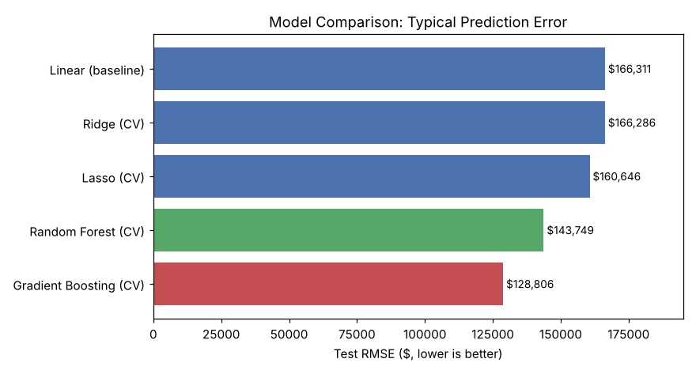
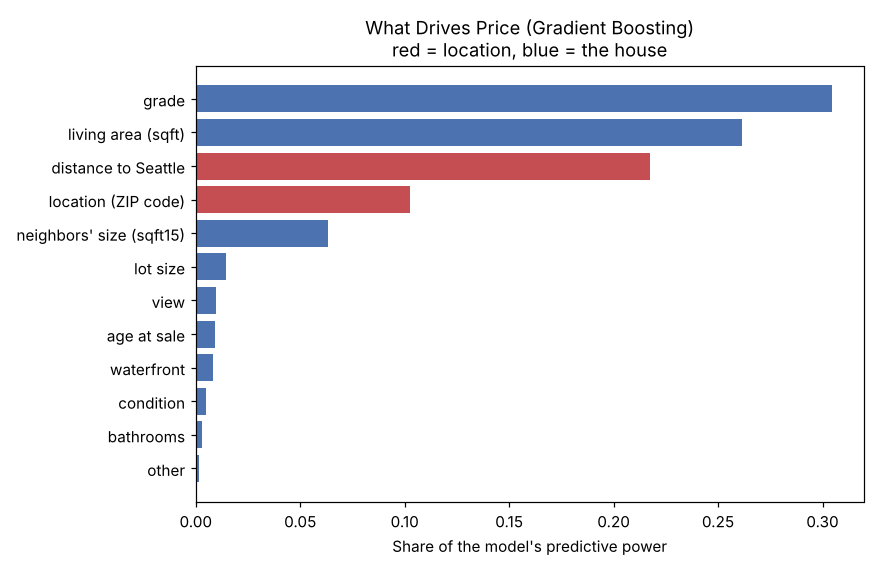
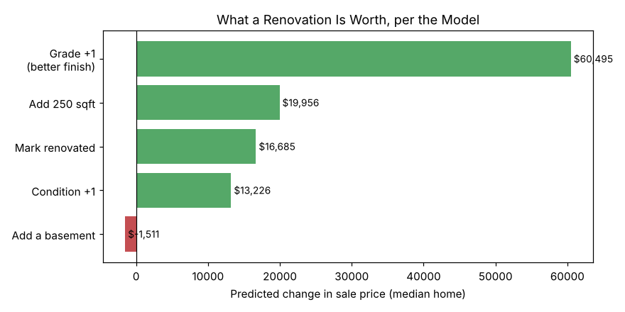

# What Drives the Price of a Home? Separating the House from the Neighborhood

**Author:** Neda Nadjmabadi

## Executive summary

When someone sells a home, they want to know two things: what it is worth, and what they can do to raise that number. This project answers both using about 21,000 real home sales. I built a model that estimates a home's sale price from its features and location, and I used it to separate the part of the price that comes from the house itself from the part that comes from the neighborhood around it. The best model predicts price with a typical error of about $129,000 and explains roughly 88% of what makes one home sell for more than another. The headline result for a seller is simple: about two thirds of a home's price comes from the house (its quality and size) and about one third from its location, and the renovations that actually move the number are the ones that improve finish quality and add real living space, not bedroom counts or a finished basement.

## Rationale

This matters most to someone preparing to sell an older home. They face a list of spending decisions with no clear way to rank them. Do you redo the kitchen or just refresh it? Is finishing the basement worth it, or is that thousands of dollars you will never see again? Does a nicer finish actually raise the price, or does it just feel productive? Most sellers answer these questions on instinct, or they trust a contractor whose income depends on recommending more work. If nobody answers them clearly, people keep over-improving in the wrong places and pricing on gut feeling instead of evidence. This project turns the question into a ranked, dollar-based answer that someone with no data background can act on.

## Research Question

Which features of a home, and which qualities of its location, have the biggest effect on its sale price, and how accurately can we predict what a house will sell for once we account for both?

## Data Sources

King County, Washington home sales from May 2014 to May 2015, about 21,000 sold homes. Each row is one sale and records the home's physical attributes (living area, lot size, bedrooms, bathrooms, floors, construction grade, condition, year built, year renovated, basement, waterfront, view), its location (ZIP code, latitude, longitude), and the final sale price. The data is a widely used public housing dataset and arrived with no missing values. A copy is stored in [`data/kc_house_data.csv`](data/kc_house_data.csv).

A note on the dataset choice. The original proposal named the Ames, Iowa housing data. I moved to King County because it includes latitude, longitude, and ZIP code, which are exactly the location signals this question is about. The standard Ames data does not carry those geographic fields, so it could not support the location half of the analysis.

## Methodology

The project follows the CRISP-DM process: understand the business problem, understand and clean the data, engineer useful features, model, and evaluate.

After cleaning (parsing the sale date, keeping only the most recent sale for homes that sold twice, and removing a few impossible records such as a 33-bedroom data-entry error), I built features that express the question directly: how old the home was at sale, whether it had been renovated, whether it has a basement, and the straight-line distance from each home to downtown Seattle as a stand-in for proximity to the city. The neighborhood itself enters the models as the ZIP code, so each of the 70 areas can carry its own price level without me hand-building a score and without leaking price information into the features.

I predict the logarithm of price so the errors read as percentages and the long tail of expensive homes does not dominate, then convert predictions back to dollars. I fit five models from simple to flexible: Linear Regression as a baseline, Ridge and Lasso (linear models with regularization), and two tree ensembles, Random Forest and Gradient Boosting. The regularized and ensemble models were tuned with cross-validation and grid search. The headline metric is RMSE in dollars, chosen because the audience thinks in dollars and RMSE penalizes the large misses that matter most on a purchase this size. I report typical error (MAE) and share of variation explained (R²) alongside it.

## Results

All five models beat a naive guess (predicting the average price for everyone, which is off by about $391,000) by a wide margin, and accuracy improved as the models grew more flexible. Gradient Boosting was the best.

| Model | Typical error (RMSE) | R² |
|---|---|---|
| Linear (baseline) | $166,311 | 0.876 |
| Ridge | $166,286 | 0.876 |
| Lasso | $160,646 | 0.870 |
| Random Forest | $143,749 | 0.872 |
| **Gradient Boosting** | **$128,806** | **0.879** |

When I ask the best model what it relies on, the price of a home splits into two parts: about **68% comes from the house itself** and about **32% comes from its location**. On the house side, construction grade and living area are far and away the biggest levers. On the location side, distance to the city and ZIP code together form the next largest block. Neighborhoods are not a footnote here: median prices differ about 8x between the cheapest and most expensive ZIP codes.

To make this useful to a seller, I used the model as a what-if tool: take each home, improve one feature by a realistic amount, and measure how much the predicted price moves. The ranking is clear. Raising a home's construction grade by one step, meaning a genuinely higher-quality finish, is worth about $60,000 on the median home. Adding real living space is worth about $20,000 per 250 square feet. Improving condition or recording a renovation adds a smaller amount. Adding a basement, on its own, adds essentially nothing.

These are model-based associations rather than guaranteed returns, but they rank the choices in a sensible, consistent order that a seller can plan around.

## Important findings for a non-technical reader

A home's price comes from two sources, and only one of them is in the owner's control. Location is inherited: a home in a close-in, high-demand ZIP code already carries much of its value, and no amount of renovation will change where it sits. The house itself is where spending can pay back, and there the money should go toward overall quality and usable space rather than toward counts. A higher-quality finish and more living area moved the predicted price the most. A finished basement, an extra bedroom on paper, and an added floor moved it very little once quality and size were accounted for.

The practical takeaway: before spending a dollar on an older home, look at where it sits. If it is in a strong neighborhood, the location is already doing the work and heavy renovation has less room to pay back. If it is farther out, the house has to compete on its own merits, so targeted upgrades to quality and space matter more. Either way, price the home with both levers in view, and put the renovation budget where the evidence says it returns.

## Next steps

Build a small calculator so a seller can enter a home's details and see an estimated price along with its top value levers. Add outside neighborhood data such as schools, transit, and crime to deepen the location side beyond distance and ZIP code. Test the approach on a more recent year and a different metro area to confirm it transfers. And turn the what-if analysis into clearer dollar ranges for each upgrade using partial-dependence analysis.

## Project organization

- [`notebooks/capstone_analysis.ipynb`](notebooks/capstone_analysis.ipynb) — the full analysis: data cleaning, exploratory analysis, feature engineering, five models with cross-validation and grid search, model comparison, and the renovation what-if.
- [`data/kc_house_data.csv`](data/kc_house_data.csv) — the dataset.
- [`images/`](images/) — figures used in this report.

## Contact and Further Information

Neda Nadjmabadi
